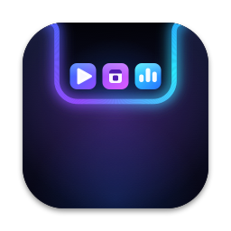

  

<h1 align="center">NotchEVSR</h1>

Turns the notch on your MacBook into a panel for music, your calendar, apps, a file shelf and more.

<h3 align="center">
  <a href="https://github.com/MilkshakeEV/NotchEVSR/releases/latest/download/NotchEVSR.dmg">⬇︎ Download NotchEVSR</a>
</h3>

<a href="https://github.com/MilkshakeEV/NotchEVSR/releases/latest/download/NotchEVSR.dmg">NotchEVSR.dmg</a> · always the newest version

## Requirements

- A Mac with Apple silicon (M1 or later)
- macOS 14 Sonoma or newer

## Install

1. Download **NotchEVSR.dmg** with the button above and open it.
2. Drag **NotchEVSR** onto the **Applications** folder.
3. Open it from Applications. The first time, macOS says it can't check the app: click **Done**,
   then open **System Settings → Privacy & Security**, scroll to **Security** and click
   **Open Anyway** next to NotchEVSR. You only do this once.

More detail, including what to do if the Open Anyway button doesn't appear: [INSTALL.md](INSTALL.md).

## What it does

Hover over the notch to open it:

- **Now Playing**: what's playing in any app, with controls
- **Calendar**: your Apple Calendar, with countdowns and Join buttons
- **Apps**: running apps and your own favourites
- **Shelf**: park files and drag them out later, or send them with AirDrop
- **Temperatures**: CPU, GPU, battery and fans
- **Split View**: up to six of these at once

## Updates

Open **Settings → Updates** and click **Check for Updates**. Updates install one version at a
time, and every download is verified against its signature before it's installed. You can roll
back to the previous version from the same screen.

## Privacy

No accounts, no tracking, nothing uploaded. The only network traffic is checking for and
downloading updates from this page, which sends nothing but the app's name and version.

[All releases](https://github.com/MilkshakeEV/NotchEVSR/releases)
